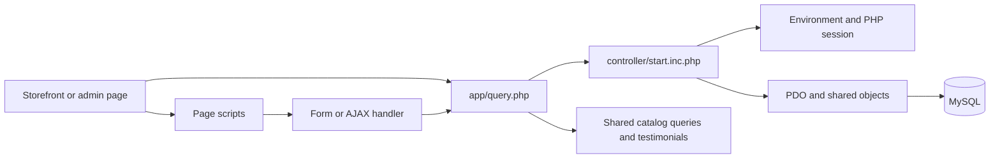
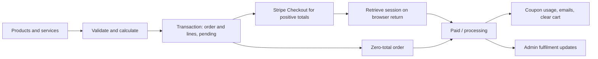

# Queenzy Mart application guide

Verified against the local source and `mart_a99_queenzy` database on 2026-11-07. This is a reference for working in this checkout. Local database observations describe the ongoing restore, not the production database. Runtime workflows below were traced in source; checkout, email delivery, and authenticated browser journeys were not exercised during this review.

**Subsequent implementation:** see [Cart sharing and mobile navigation](CART_WHATSAPP_RELEASE.md) for the WhatsApp feature, mobile fixes, local identity-key repairs, and verified guest/authenticated cart behaviour completed after this original learning snapshot. The historical missing-key and pricing/routing observations below have been addressed to the extent documented in that release note.

## 1. Product and business model

Queenzy African Stores & Braids Salon combines retail shopping and salon bookings. The local catalog has four sections: Queenzy African Store, Queenzy Fashion Store, Queenzy Beauty and Hair Store, and Queenzy Salon. Categories belong to sections; products and services belong to categories.

Customers can browse products, search, use quick view, manage a guest cart, register and verify an email address, log in, maintain a profile, book services, check out, review orders, and download invoices. Product and service lines share a checkout and order. Checkout is oriented toward the UK: prices are displayed in pounds, Stripe uses GBP, and delivery validates UK phone numbers and postcodes.

The admin console manages the catalog, orders, delivery settings and zones, coupons, testimonials, administrator accounts, and site settings. Its user manager mainly lists customers and their order spending; it is not a complete customer account administration workflow.

## 2. Structure and request lifecycle

This is a framework-free PHP application with direct `.php` URLs, server-rendered HTML, and jQuery/fetch enhancements. There is no central routing framework or frontend build step required by the application code inspected.

| Location | Responsibility |
| --- | --- |
| [index.php](../index.php) | Loads shared initialization and redirects to the storefront. |
| [view/](../view/) | Customer pages, reusable includes, storefront assets, and uploaded images. |
| [console/](../console/) | Admin pages and Ekka dashboard assets. |
| [app/](../app/) | Shared query initialization, form handlers, AJAX endpoints, mail helper, and Composer dependencies. |
| [controller/](../controller/) | Bootstrap, environment loader, PDO/model helpers, cart, users, utility methods, and payment wrappers. |

[app/query.php](../app/query.php) locates the bootstrap using relative paths, loads the main Composer autoloader and admin helpers, optionally loads the current user, and runs several catalog queries plus testimonial loading. This work happens for handlers as well as pages. Initialization is therefore coupled to catalog tables even for authentication and AJAX requests.

[controller/start.inc.php](../controller/start.inc.php) starts the session, loads environment values and classes, opens PDO, and creates `$model`, `$utility`, `$generator`, `$paystack`, `$product`, `$cart`, `$user`, and `$stripe`. The active connection is created here; [db.inc.php](../controller/db.inc.php) contains a separate connection class with no call site found in first-party application code.

[Model](../controller/model.class.php) provides `getRows`, `getById`, `insert`, `update`, `delete`, `exists`, `search`, aggregates, prepared statements, and transactions. `getRows` expects options such as `where`, `where_raw`, `select`, `left_join`, `order_by`, `limit`, and `return_type`. Joins use arrays. Passing a condition at the top level instead of under `where`, or passing `order` instead of `order_by`, does not apply that condition/order.

Many forms encode their `action` using `Utility::inputEncode`, which is hex encoding of Base64 text. AJAX cart actions use plain strings. These action values select handler branches; encoding is reversible and is not an authorization or CSRF control.

## 3. Data model and identifiers

These are logical relationships used by the code. They are not a claim that foreign keys are currently installed locally.

| Entity | Identifier and relationship |
| --- | --- |
| `sections` | `id`; catalog section. |
| `categories` | `categoryTbl_id`; `section_id` points to `sections.id`. |
| `products` | `product_id`; `category_id` points to `categories.categoryTbl_id`; slug and SKU are unique in the restored products table. |
| `services` | `id`; `services_categoryID` points to the category; price is `base_price`. |
| `users_mart` | `user_id`; email, phone, password hash, verification state and token. |
| `user_profiles` | `profile_id`; `user_id` links the customer's name and address details. |
| `password_resets` | `id`; user, token, and expiry time. |
| `admins` | `admin_id`; separate admin credentials, role, and optional status support in code. |
| `cart` | `cart_id`; session ownership for guests and user ownership after login. |
| `cart_items` | `cart_item_id`; `cart_id`, `product_id`, quantity, and saved unit price. |
| `service_cart_items` | `service_cart_item_id`; `cart_id`, `service_id`, quantity, and saved unit price. |
| `orders_mart` | `order_tbl_id`; customer, reference, contact/address snapshot, appointment, totals, payment and fulfilment state. |
| `order_items_mart` | `id` identifies a line. **`order_item_id` points to the parent order**, despite its name. |
| `delivery_settings` | Code reads configuration row `id = 1`. |
| `delivery_zones` | `zone_id`; named zone, fee, and active state. |
| `coupons` | `coupon_id`; code, type/value, minimum, validity window, usage limit/count, and status. |
| `coupon_usage` | `usage_id`; coupon and order links, user, code, and discount snapshot. |
| `site_settings` | `setting_id`; unique `setting_key` and text `setting_value`. |
| `testimonials` | Local identifier is `id`; review helpers also recognize legacy column names. |
| `utils` | `UID`; legacy utility data table, with no first-party consumer found during this review. |

For order lines, `orderType` distinguishes `product` and `service`. `product_id` stores a product ID or a service ID according to that type. Preserve this distinction in reports and joins. Lines snapshot the name, unit price, quantity, and subtotal.

Product, category, and section statuses use `Active`, `Inactive`, and `Deleted`. Services use lowercase `active` and `inactive`. Several newer helpers normalize case, but not every query does. Product/category/section deletion generally changes status rather than physically removing records; coupons are deactivated by their delete action. Testimonials can be physically deleted.

### Local restore snapshot

Read-only checks found 20 tables, 500 products, 20 categories, four sections, nine services, one administrator, and ten orders. No products referenced a missing category, and no categories referenced a missing section.

**Eleven local tables have no primary key:** `admins`, `cart`, `cart_items`, `categories`, `coupon_usage`, `coupons`, `delivery_settings`, `delivery_zones`, `order_items_mart`, `orders_mart`, and `password_resets`. Their ID columns also showed no `AUTO_INCREMENT`. There are zero installed foreign-key constraints across this database. This suggests the restore may be missing index/auto-increment/constraint statements; confirm against the complete original exports before repairing anything. Inserts that omit those IDs cannot be assumed to work.

The products export from MariaDB 11.4 required changing `date DEFAULT curdate()` to `date DEFAULT (curdate())` for local MySQL 8.4.3. [products.mysql.sql](../products.mysql.sql) contains that single correction. Its category foreign key requires the category table and an appropriate referenced index to exist. The earlier temporary-table import test loaded all 500 rows and verified the date default, excluding that foreign key.

## 4. Customer workflows

### Catalog and discovery

- [index.php](../view/index.php) renders homepage sections, category tabs, products, service content, and testimonials.
- [shop.php](../view/shop.php) and [viewcategory.php](../view/viewcategory.php) load product batches through AJAX. The current category is stored in `$_SESSION['categoryId']`.
- [search.php](../view/search.php) searches product names and descriptions through `Model::search`.
- [viewproduct.php](../view/viewproduct.php) expects `?id=PRODUCT_ID`; [viewservice.php](../view/viewservice.php) expects `?slug=SERVICE_SLUG`.
- [productCard.php](../view/inc/productCard.php) is the shared product card used by active listings. Quick view calls [get_product_details.php](../app/ajax/get_product_details.php).

Shop/category infinite scrolling is driven by [fetchproduct.js](../view/assets/js/fetchproduct.js), with batches of eight. A separate `fetchcatproduct.js` also exists; the shared footer loads `fetchproduct.js`.

### Accounts and profiles

[user_access_action.php](../app/user_access_action.php) handles registration, login, verification resend, logout, and password reset. [User](../controller/user.class.php) hashes passwords using bcrypt, generates verification tokens, requires verified email for login, and sends account/order messages. Verification enters through [verify.php](../app/verify.php).

Customer identity uses `$_SESSION['user_id']` and `user_email`. Login assigns guest cart records matching the session ID to the user. Profile AJAX endpoints take identity from the session and read/write `user_profiles`. Password reset creates a token expiring after one hour, sends a link, and processes the replacement password through the user action handler. Logout destroys the whole PHP session, which also contains admin identity when present.

### Cart and service booking

[Cart](../controller/cart.class.php) selects the oldest cart for the current user or guest session, creates one when needed, and merges duplicate cart headers and lines. Products and services have separate line tables but a common summary. Quantities are at least one; the count is the sum of quantities across both types.

**Cart reads have database side effects.** Summary/item/count calls can create a cart, merge duplicates, remove unavailable lines, and delete expired product/service lines across carts. Expiry cleanup runs once per PHP request, defaults to 30 days, reads `site_settings.cart_expiry_days`, and caps the effective setting at 365 days. Older schemas fall back from line `added_at` to cart `created_at`.

[cart_action.php](../app/ajax/cart_action.php) handles add, remove, quantity update, count, item lookup, and sidebar HTML. Add-to-cart selects the active product and chooses `discount_price` when nonempty, otherwise `price`. Cart lines retain their saved price; checkout sums those saved prices. [manageCart.js](../view/assets/js/manageCart.js) synchronizes buttons, counts, sidebar, and quantity totals. [get_cart_items.php](../app/ajax/get_cart_items.php) returns sidebar HTML and totals.

[booking.php](../view/booking.php) allows multiple active services. [bookingHandler.php](../app/bookingHandler.php) adds their current base prices to the service cart and redirects to checkout. The order holds one appointment date/time for the service lines. There is no separate appointment availability/capacity engine or booking table in the inspected implementation.

### Checkout and calculation

[checkout.php](../view/checkout.php) provides the form; [checkoutFormValidator.js](../view/assets/js/checkoutFormValidator.js) adjusts required fields and refreshes totals through [checkout_action.php](../app/ajax/checkout_action.php). [orderHandler.php](../app/orderHandler.php) validates and recalculates before writing.

The main rules live in [store_helpers.php](../controller/store_helpers.php):

- Product carts require an explicit delivery/pickup choice. Service-only carts select a fulfilment mode from settings, normally pickup.
- Delivery requires address line 1, city, and a UK postcode. Pickup clears the saved delivery address. Checkout requires a valid email, a `+44` phone number, privacy consent, and customer login.
- Pickup has no delivery fee. Delivery uses an active selected zone's fee or the default fee. Free delivery is based on the cart subtotal before coupon discount.
- Missing delivery configuration falls back to both modes enabled, a GBP 10 delivery fee, free delivery from GBP 100, and the Larkhall pickup address.
- Coupons are uppercase, fixed or percentage, and validated for status, dates, minimum subtotal, and total usage limit. Discount is capped at the subtotal; it does not directly discount delivery.
- Total is `max(0, subtotal + delivery_fee - discount)`. Monetary results are rounded to two decimal places.
- Service carts require appointment fields in the form. The handler also uses `2000-01-01` / `00:00:00` sentinels, so do not assume the existing server check proves a real future appointment was selected.

### Orders and payment

Orders and lines are created in a transaction before Stripe initialization. The current order ID is stored in `$_SESSION['orderId']`. With a coupon, Stripe receives one aggregate line for the final total; otherwise it receives item lines plus delivery. Amounts are converted to minor units by multiplying by 100.

[paymentHandler.php](../app/paymentHandler.php) retrieves the Stripe session supplied on browser return and updates the session-selected order. Paid orders become `processing`; unsuccessful paths use pending/failed states. Paid and zero-total paths record coupon usage, send customer order/payment emails and an admin notification, then clear the cart.

`qs_record_coupon_usage` checks for an existing order usage entry, inserts one, and increments the coupon count. It is separate from the original order transaction. `qs_order_financials` reconciles newer subtotal/discount/delivery columns with older orders for display and email.

Customer [order.php](../view/order.php), [orderDetails.php](../view/orderDetails.php), and [invoice-pdf.php](../view/invoice-pdf.php) use session identity and order ownership. Dompdf generates an A4 invoice download. Success/failure pages use the current session order ID.

## 5. Admin workflows

[console/index.php](../console/index.php) is the login page. [admin_access_action.php](../app/admin/admin_access_action.php) verifies the admin password and status, then sets `admin_id`, `admin_name`, and `admin_role`. [console/inc/head.php](../console/inc/head.php) checks `admin_id` for console pages. No role-specific navigation enforcement was found; storing a role is not evidence of complete RBAC.

| Workflow | Page and mutation handler |
| --- | --- |
| Sections | `console/section_mgr.php`, `editsection.php` -> `app/admin/sectionhandler.php` |
| Categories | `console/category_mgr.php`, `editcategory.php` -> `app/admin/categoryHandler.php` |
| Products | `console/product_mgr.php`, `add-product.php`, `editproduct.php`, `duplicateproduct.php` -> `app/admin/productHandler.php` |
| Services | `console/servicemgr.php`, `editservice.php` -> `app/admin/serviceHandler.php` |
| Order fulfilment | `console/orders.php`, `order-details.php` -> `app/admin/orderHandler.php` |
| Delivery | `console/delivery_mgr.php` -> `app/admin/deliveryHandler.php` |
| Coupons | `console/coupon_mgr.php` -> `app/admin/couponHandler.php` |
| Testimonials | `console/reviews.php` -> `app/admin/reviewHandler.php` |
| Administrators | `console/admins.php` -> `app/admin/adminHandler.php` |
| Site settings | `console/settings.php` -> `app/admin/settingsHandler.php` |

Product creation generates a SKU from category and brand abbreviations plus the next product number. Main images and galleries are uploaded separately. Existing image values are kept in session while editing, so simultaneous edit tabs deserve care.

Admin order updates accept `pending`, `processing`, `ready_for_pickup`, `dispatched`, `delivered`, `completed`, and `cancelled`, plus delivery status/date. This handler changes fulfilment state rather than processing a Stripe refund.

[admin_helpers.php](../controller/admin_helpers.php) inspects table/column presence and supports legacy testimonial schemas. Site settings are key/value records. Some settings are editable but are not wired through all storefront/email code; the cart expiry setting has a direct runtime consumer.

Dashboard revenue sums paid orders. Some other metrics are different: customer-manager spending includes orders regardless of payment state, the dashboard's product growth percentage is random placeholder data, and top-product aggregation does not distinguish paid orders or service lines. Do not treat every dashboard figure as a reconciled financial metric.

## 6. Integrations, configuration, and assets

- [controller/env.php](../controller/env.php) loads the root `.env` without overriding existing environment values. Blank values fall back to defaults. It does not load `.env.local`.
- Bootstrap keys: `APP_NAME`, `DB_HOST`, `DB_NAME`, `DB_USER`, `DB_PASSWORD`, `STRIPE_SECRET_KEY`, and `PAYSTACK_SECRET_KEY`.
- Mail keys: `SMTP_HOST`, `SMTP_AUTH`, `SMTP_USERNAME`, `SMTP_PASSWORD`, `SMTP_PORT`, `SMTP_SECURE`, `MAIL_FROM_ADDRESS`, `MAIL_FROM_NAME`, and `ADMIN_ORDER_EMAIL`. PHPMailer is used by `User` and [app/mail_config.php](../app/mail_config.php).
- `APP_URL` appears as a settings form default. Verification/reset links, homepage calls to action, and Stripe return URLs still contain the production hostname directly. Changing one environment variable does not currently make every local URL local.
- [StripePayment](../controller/stripe.class.php) uses cURL directly. It defines refund and webhook-signature methods, but no first-party caller for these methods was found. The active payment completion path is the browser-return handler. A [Paystack wrapper](../controller/paystack.class.php) is initialized, with no active checkout call site found.
- [app/composer.json](../app/composer.json) declares PHPMailer and Dompdf. [app/phpqrcode/composer.json](../app/phpqrcode/composer.json) separately declares Endroid QR Code 5.x. The bootstrap loads QR dependencies through their own autoloader.
- Storefront shared layout: `view/inc/mainhead.php` for the homepage, `view/inc/head.php` for other pages, plus `header.php`, `category.php`, `cart.php`, and `footer.php`. Theme assets include Ekka styles, Bootstrap, jQuery, sliders, and quick-view support.
- Admin shared layout uses `console/inc/head.php`, `navbar.php`, `header.php`, and `footer.php`, with Bootstrap, DataTables, charts, and Ekka dashboard styling.
- Product main filenames are stored in `image_main`; gallery filenames are a JSON array in `image_gallery`. Files live under `view/assets/images/product/main/` and `product/thumbs/`. Category and service image values include relative image subdirectories.
- Delivery, return, and privacy policy pages are static content. The return page describes a 30-day policy with exclusions; this is presentation content, not an automated returns/refund module. Delivery content describes 3-4 working days.

## 7. Compatibility points and unresolved observations

These are source/schema observations for future tasks, not a completed security audit or a claim that the app has been tested end to end.

1. **Restore completeness:** the missing local primary keys, auto-increment attributes, and foreign keys need to be reconciled with the original exports before relying on new writes. Preserve imported identities and historical links.
2. **Admin role mismatch:** local `admins.role` permits `superadmin`, `manager`, and `staff`, whereas the current admin form/handler offers `admin`, `manager`, and `staff`. Creating or editing the first role needs schema alignment.
3. **Handler access boundaries:** console page session guards do not automatically protect direct requests to `app/admin/` handlers. Those inspected load shared initialization without an equivalent common admin authorization check. Encoded actions provide no access control. Review this explicitly before changing admin behavior.
4. **Payments:** the active callback selects an order using PHP session state. Order/session binding, amount/currency checks, repeat callbacks, abandoned payments, and multiple checkout tabs need dedicated validation. The Stripe cURL wrapper currently disables TLS certificate verification. These behaviors were not changed or exercised here.
5. **Inventory and appointments:** no stock reservation/decrement path or appointment capacity/calendar enforcement was found in the inspected checkout/payment flow. Catalog stock and service duration do not establish those guarantees.
6. **Pricing consistency:** cards and quick view display `price` as the new price and `discount_price` as the old price, while add-to-cart charges nonempty `discount_price`. Confirm the intended pricing semantics before modifying discount behavior.
7. **Routing and legacy helpers:** product detail expects an ID, but cart item URLs currently use a slug. `Product` class queries use generic `id` fields and string joins that differ from the live identifiers and `Model` join contract; active storefront pages generally query `Model` directly. The legacy resend method also uses older user field names, while the active resend action calls `sendVerificationEmail` directly.
8. **Service mutations:** lower branches in `serviceHandler.php` still contain category toggle/delete logic. Do not assume they implement service deactivation/deletion merely because the file handles service creation and editing.
9. **Initialization and errors:** shared initialization runs catalog queries for most requests, some views emit HTML before redirect logic, and debug/error paths can expose database details or user/token data. Do not interpret PHP syntax checks as proof these runtime paths work correctly.
10. **Missing setup artifacts:** pages reference `database_updates_delivery_coupon_cart.sql` and `database_updates_admin_menu_integrations.sql`, but no migration SQL or complete database dump was tracked in this checkout when reviewed. The corrected products-only dump is not a complete application database installer.

## 8. Working on this app

Follow the existing PHP/model/session and Ekka UI structure for focused changes. Use the identifiers in this guide rather than assuming each table has an `id`. Trace the page, JavaScript, handler, model/helper, and table together when changing a workflow. For order calculations, use the shared totals and legacy-financial helpers so checkout, confirmation emails, admin details, and invoices stay aligned.

For a catalog change, check homepage cards, shop/category AJAX listings, quick view, search, product detail, and cart. For checkout changes, account for guest-to-user cart assignment, products, services, mixed carts, delivery, pickup, coupons, payment result handling, and historical orders. Live integrations and production links require a deliberate environment setup before local journey tests.

This learning pass changed documentation only. Source/schema inspection and aggregate queries did not change application tables. Local PHP CLI is 8.2.28 and MySQL is 8.4.3; required PDO MySQL, cURL, GD, mbstring, DOM, and OpenSSL extensions are present. All 99 first-party PHP files passed `php -l`, and 11 custom storefront JavaScript files passed `node --check`. All relative links in this guide resolved. These checks are not functional payment/email/UI validation. No first-party automated test suite was found outside bundled vendor/theme tests.
